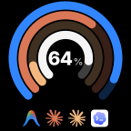
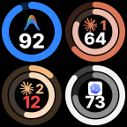
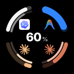
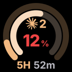
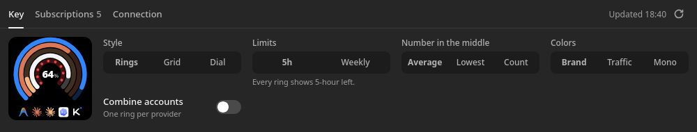
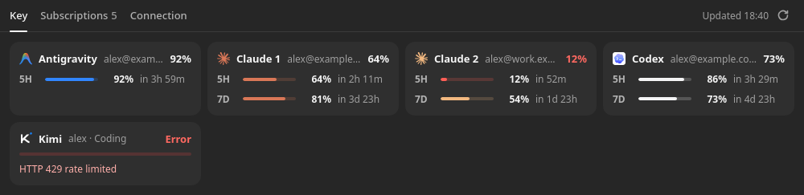

# CLIProxyAPI Quotas for OpenDeck

See how much of each AI subscription you have left — Claude, Codex, Antigravity, Kimi, Grok — on your Stream Deck, read live from [CLIProxyAPI](https://github.com/router-for-me/CLIProxyAPI) through [OpenDeck](https://github.com/nekename/OpenDeck). Press a key to reload.

<table>
  <tr>
    <td align="center"><br><sub>Rings</sub></td>
    <td align="center"><br><sub>Grid</sub></td>
    <td align="center"><br><sub>Dial</sub></td>
    <td align="center"><br><sub>Detail</sub></td>
  </tr>
</table>

The plugin only reads from CLIProxyAPI. It never changes its config, credentials or cooldowns.

## Keys

**All Subscriptions** puts every subscription on one key, in one of three styles:

- **Rings** — one ring per subscription, all showing the same limit (5h or weekly). Logos underneath, left to right = outer to inner. The middle shows the average, the lowest, or the count.
- **Grid** — a small dial per subscription with its logo and % left. Outer ring 5h, inner ring weekly.
- **Dial** — one ring split into an arc per subscription, each with its logo. Outer band 5h, inner band weekly.

**Subscription Detail** shows one subscription: outer ring 5h, inner ring weekly, the % left of whichever is lower, and when it resets (`5H 52m`, `WK 2d 4h`).

Each subscription keeps its own colour on every key, so two accounts of the same provider can be told apart. Everything is sized for the 72px keys of a Stream Deck MK.2. On a Stream Deck+, turning the dial switches style (or subscription) and pressing it reloads.

## Requirements

- [OpenDeck](https://github.com/nekename/OpenDeck)
- [CLIProxyAPI](https://github.com/router-for-me/CLIProxyAPI) with the management API enabled (`management.secret-key` set in `config.yaml`)
- Node.js 20 or newer on your `PATH` — OpenDeck runs the plugin with it

## Install

1. Download `dev.cliproxyapi.opendeck.streamDeckPlugin` from the [latest release](../../releases/latest).
2. In OpenDeck, open **Plugins** → **Install from file** and pick the file.
3. Drag **All Subscriptions** or **Subscription Detail** from the **CLIProxyAPI** category onto a key.
4. In the key's settings, open **Connection**, enter the server URL (default `http://127.0.0.1:8317`) and your management password, and press **Save and connect**.

Use the plain password you sign in to the CLIProxyAPI Control Panel with. CLIProxyAPI stores it as a `$2a$…` hash in `config.yaml`; that hash won't work here.



The **Subscriptions** tab lists every account with its 5h and weekly bars and reset times:



## Supported providers

| Provider | Limits shown |
| --- | --- |
| Claude | 5-hour, weekly |
| Codex (ChatGPT) | 5-hour, weekly |
| Antigravity | the limits it reports |
| Kimi | the limits it reports |
| Grok (xAI) | the limits it reports |
| Any CLIProxyAPI v8 quota plugin | the limits it reports |

Other providers show up with a letter tile until they get a logo.

## Privacy and safety

- Nothing in CLIProxyAPI is changed. The plugin lists your accounts (`/v0/management/auth-files` or `/v8/management/credentials`), and asks CLIProxyAPI to look up each account's usage with the provider through `api-call`. It never edits config, credentials or cooldowns, and never drains the usage queue.
- The password is kept in OpenDeck's settings on your computer and only sent to the server URL you entered.
- CLIProxyAPI blocks an address for a while after 5 wrong passwords. The plugin stops after the first rejection and waits for you to save again, so a wrong password can't lock you out by itself.

## Troubleshooting

| The settings say | What to do |
| --- | --- |
| **Password rejected** | Check the password and save again. |
| **Wrong kind of password** | You pasted the `$2a$…` hash. Use the plain password. |
| **Blocked by CLIProxyAPI** | Too many wrong passwords. Wait about 30 minutes or restart CLIProxyAPI, then save with the right one. |
| **Can't reach CLIProxyAPI** | Make sure it is running and the URL is right. |

## Development

No dependencies; Node 20+ only.

```bash
npm test                    # quota parsing, API client, renderer, plugin lifecycle
npm run preview             # docs/keys/*.svg and dist/preview.html from sample data
npm run install:opendeck    # copy the plugin into OpenDeck's plugin folder
npm run pack:plugin         # build dist/dev.cliproxyapi.opendeck.streamDeckPlugin
npm run icons               # regenerate the plugin, action and default key icons
```

Provider logos are generated from [LobeHub Icons](https://github.com/lobehub/lobe-icons):

```bash
mkdir /tmp/lobe && cd /tmp/lobe && npm pack @lobehub/icons-static-svg && tar xzf *.tgz
node scripts/vendor-logos.mjs /tmp/lobe/package
```

Releases are built by GitHub Actions: bump `Version` in `manifest.json` and `version` in `package.json`, then push a matching tag (`git tag v1.0.0 && git push --tags`).

## Credits

Provider logos come from [LobeHub Icons](https://github.com/lobehub/lobe-icons) (MIT). They are trademarks of their owners and are used only to show which provider a quota belongs to.

## License

[MIT](LICENSE)
